<h1 align="center">
  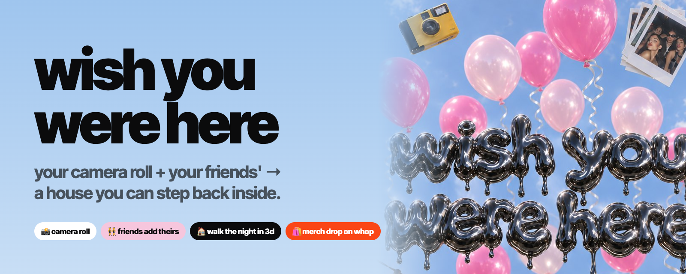
</h1>

<p align="center">
  
  
  
  
  
</p>

<p align="center">
  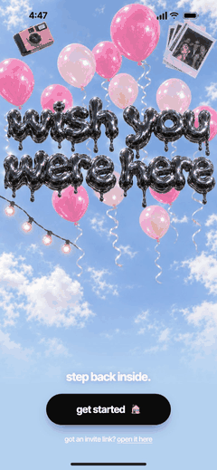<br>
  <sub><b>the whole app in 15 seconds</b></sub>
</p>

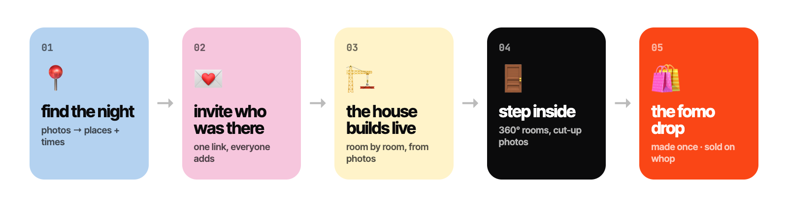

<br>

## 

<table><tr>
<td width="290">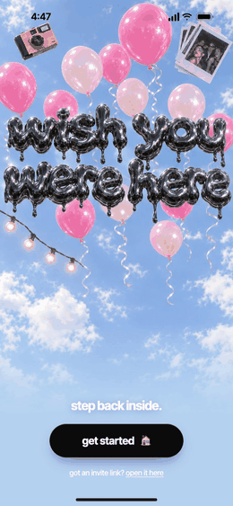</td>
<td>📸 allow photos<br><br>📍 a night pops out of your map<br><br>🎃 tap it → <b>dive in</b></td>
</tr></table>

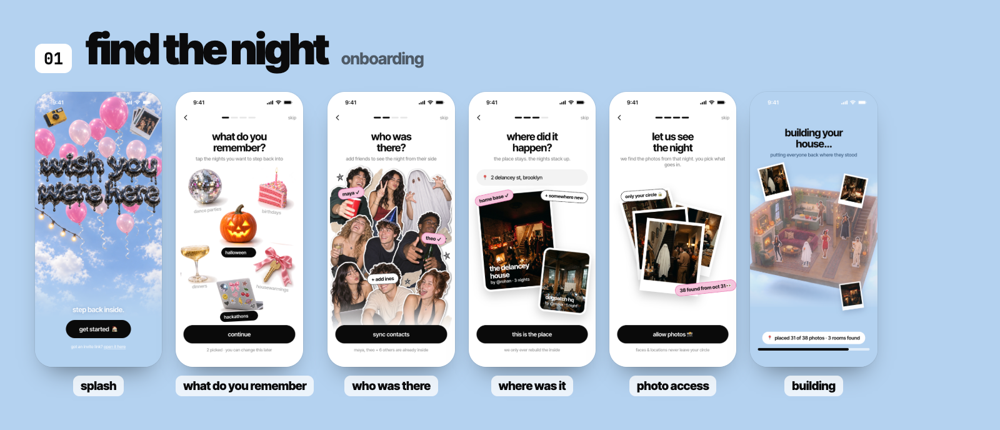

##  

<table><tr>
<td align="center">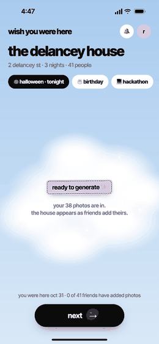<br><sub>💌 one link</sub></td>
<td align="center">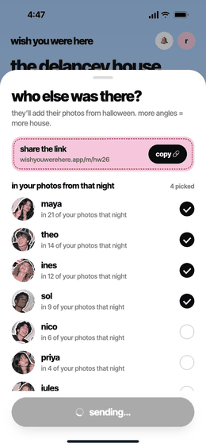<br><sub>☁️ → 🏠 every photo lands, the house appears</sub></td>
</tr></table>

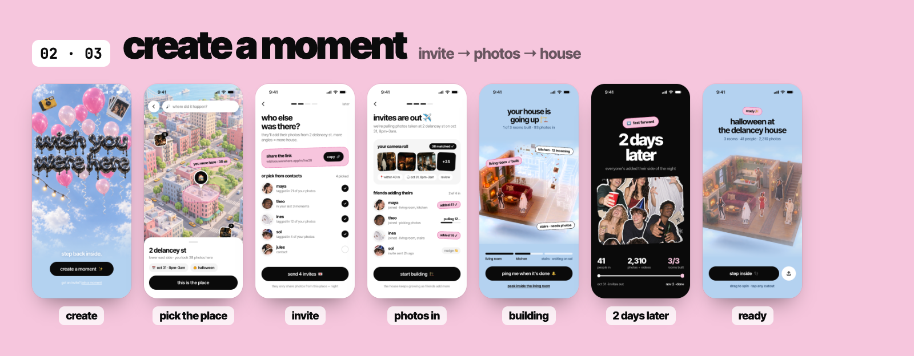

## 

<table><tr>
<td align="center">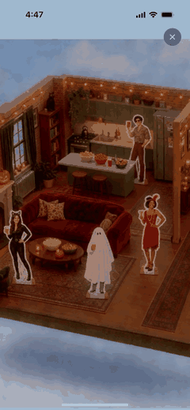<br><sub>🚪 360° rooms made of everyone's photos</sub></td>
<td align="center">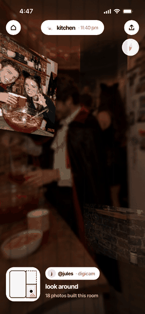<br><sub>👻 stand where they stood</sub></td>
</tr></table>

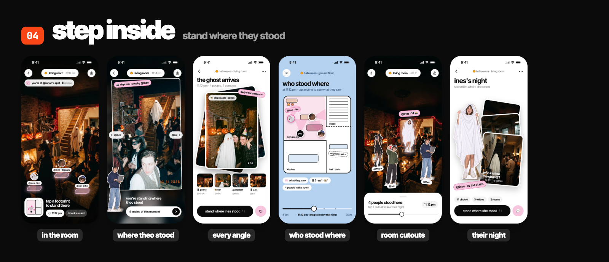

## 

<table><tr>
<td width="290">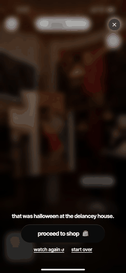</td>
<td>🔮 snow globe of <i>your</i> house<br><br>📖 photo book<br><br>👕 inside-joke capsule<br><br>⏳ made once · closes sunday<br><br>🧡 <b>sold on whop</b></td>
</tr></table>

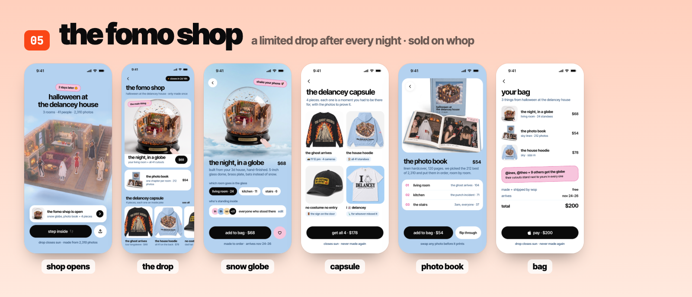

## 

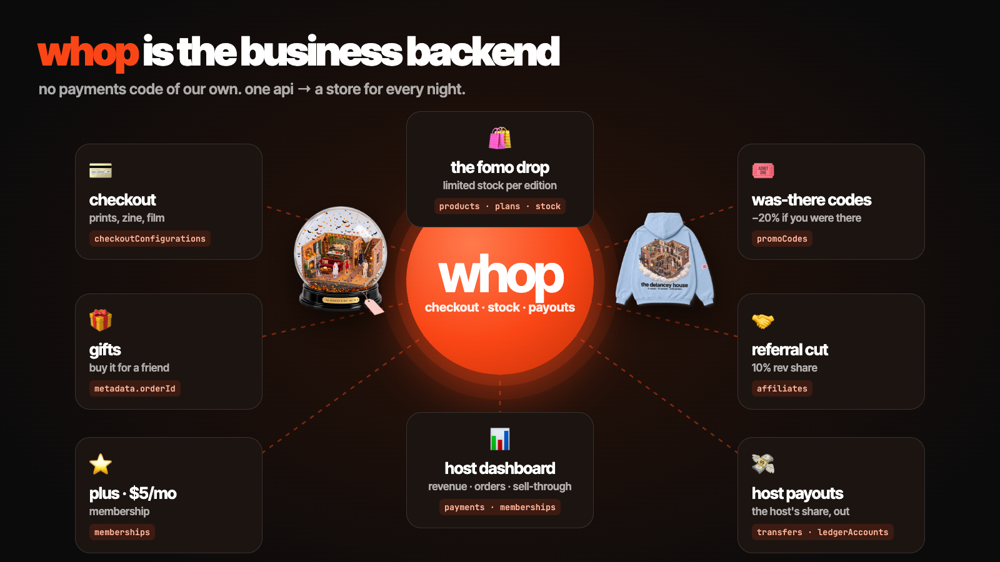

<p align="center"><sub>🧡 checkout · 🎁 gifts · ⭐ plus · 🎟️ was-there codes · 🤝 referrals · 📊 host dashboard · 💸 payouts — <a href="#how-wish-you-were-here-uses-whop">full map ↓</a></sub></p>

## 

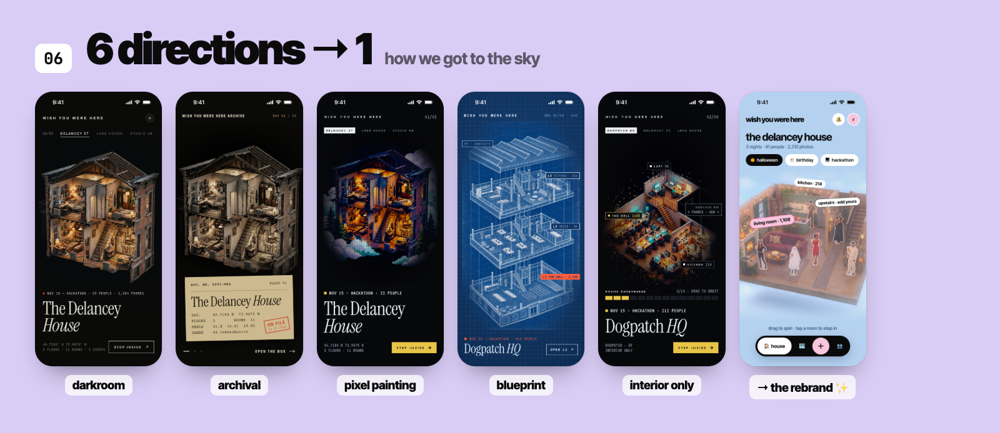

## ▶️ try it

| | |
|---|---|
| 🧪 **clickable demo** | `python3 -m http.server 4320` → [localhost:4320/prototype](prototype/) |
| 📱 **the app** | `npm install && npx expo start` |
| 🎨 **designs** | [design/](design/) · Paper: *Wish You Were Here — Mobile UI* |

<br>

---

## 🛠️ under the hood

Your camera roll already remembers the day: where you stood, which way you faced, who was there. Wish You Were Here plays it back as a narrated, walk-through replay you never had to journal, and lets you frame it.

Built at the YC Consumer Mobile Hackathon with Capy, Convex and Revyl. Expo SDK 58, Expo Router, TypeScript.

- Brief: [docs/BUILD.md](docs/BUILD.md)
- Capy context and thread prompts: [docs/CAPY.md](docs/CAPY.md)

```bash
npm install
npx expo start
```

## How Wish You Were Here uses Whop

Every way Wish You Were Here makes money runs through Whop. Convex calls the Whop SDK server side, the `/whop` webhook (`convex/http.ts`) is the only thing that marks anything paid, and the app polls Convex for the result. The full contract is in [docs/WHOP.md](docs/WHOP.md).

| Feature | Whop object / API | Where in the code |
| --- | --- | --- |
| Prints, postcards, zine, film | `checkoutConfigurations.create` (one-time variant), webhook `payment.succeeded`, `refund.created` | `convex/orders.ts`, `convex/http.ts`, `src/features/commerce/checkout.ts`, `src/app/shop/[id].tsx` |
| Gifts to a friend | same checkout with `metadata.orderId`; gift row written in the paid webhook | `convex/orders.ts`, `convex/gifts.ts`, `src/features/commerce/gifts.ts` |
| Plus ($5/mo) | renewal variant on the Plus product, `memberships.retrieve`, webhooks `membership.activated` / `deactivated` | `convex/memberships.ts`, `src/features/commerce/membership.ts`, `src/app/plus.tsx` |
| Sell this day (paid guides) | `products.create`, `variants.create`, `checkoutConfigurations.create({ variant_id })` | `convex/listings.ts`, `src/features/commerce/listings.ts`, `src/app/sell/[id].tsx`, `src/app/listing/[id].tsx` |
| The drop (limited merch) | one product per drop, one plan per edition with `stock` / `unlimited_stock: false` | `src/features/drop/api.ts`, `src/app/drop/[id].tsx` (backend: `drops:*`) |
| "was there" codes (20% off) | `promoCodes.create` (percentage, one per customer, scoped to the drop product) | `src/features/drop/promo.ts`, `src/features/drop/PromoParts.tsx`, `src/features/people/PairCelebration.tsx` |
| Referral cut (10%) | `affiliates.create`, `affiliates.overrides.create` (rev share), `affiliate_code` on checkout | `src/features/drop/promo.ts`, `src/features/drop/PromoParts.tsx` |
| Host dashboard | `payments` (revenue, orders, live feed), `memberships` (members), `plans` (sell-through) | `src/app/host/index.tsx`, `src/features/host/*` (backend: `host:stats`) |
| Host fee payout | `transfers.create`, `ledgerAccounts.retrieve` for the balance | `src/features/host/api.ts` (backend: `host:payout`) |

Wish You Were Here has no payments code of its own. Whop holds the catalog (products, plans, stock), takes the money, runs subscriptions, issues discount codes, tracks affiliates, and moves the host's share out with transfers. Convex keeps only the ids and the state the app needs to render, and it learns about money from Whop's webhooks. That is what we mean by Whop as the business backend: a host like YC gets a store, a membership, promo codes, a referral program and payouts from one API, and Wish You Were Here is the app on top.

## World Labs: build a stop in 3D

On a stop, **build this room in 3d** sends up to 8 of the stop's photos to World Labs Marble and opens the finished world in Walk in.

- **What is real:** `convex/worlds.ts` calls `POST https://api.worldlabs.ai/marble/v1/worlds:generate` (multi-image, reconstruction mode, auto layout). `worlds:poll` then checks `/marble/v1/operations/{id}` every 10 s for up to 10 min and saves the 500k SPZ splat (`assets.splats.spz_urls`) and `world_marble_url` on the `worlds` row. `trips:get` already passes ready worlds through as `worldSplatUrl` / `worldViewerUrl`. The Walk in viewer (Spark) rotates the SPZ 180° about X to undo Marble's OpenCV frame and shows a "built with world labs" chip. Generation takes about 5 minutes.
- **Demo mode (no key):** World Labs is never called. `worlds:build` inserts a row whose `operationId` starts with `demo:`, and 25 s later it turns ready with the public sample splat. Everything returns `mode: 'demo'`, and the build screen says "demo world · add a world labs key for real generation". If the backend can't take the build (not deployed, offline, or a local-only stop), the app runs the same 25 s demo on the device.
- **Turn on real generation:** `npx convex env set WORLDLABS_API_KEY <key>` (World Labs bills a $5 minimum in API credit). Photos have to be reachable at public URLs, which the uploaded Convex thumbnails are.

Code: `convex/worlds.ts` (`worlds:build`, `worlds:forMoment`, internal `worlds:poll`), `src/features/worlds/*`, `src/app/world/[id].tsx`, `src/features/walkin/WalkInViewer.tsx`.
