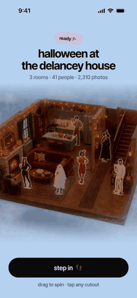

# Step inside — walking through a moment

What happens after **step inside** on `../create-a-moment/m7-moment-ready`.

## How navigation works

- **Every photo is a place to stand.** Each photo is anchored where it was taken. Those spots show as glowing footprints on the floor; tap one to move there (Street View-style, but the nodes are where friends actually stood).
- **The camera stays visible.** On landing, the real photo resolves over the 3D reconstruction with its original look intact: iPhone HDR, early-2000s digicam (hard flash, red-eye, orange date stamp), disposable film (grain, light leak), iPhone 0.5x (barrel distortion). A chip says which camera and who.
- **Always oriented.** Mini-map with your position + facing cone; the cutout of whose view you're in stands beside you.
- **Same moment, other angles.** When several people shot the same moment, swipe between their angles.

## Screens

1. `s1-standing-in-the-room` — your own spot (iPhone). Footprints for @theo (digicam), @ines (film), @sol (0.5x), mini-map, time chip, look around.
2. `s2-standing-where-theo-stood` — after hopping: theo's flash photo anchored over the blurred reconstruction, his cutout beside you, prev/next people, "4 angles of this moment".
3. `s3-one-moment-every-angle` — "the ghost arrives", 11:12 pm: swipeable stack of 4 angles with camera + person strip, "stand where ines stood".
4. `s4-who-stood-where` — top-down floor plan: everyone's spot and view cone at 11:12 pm, uncaptured hall marked "no photos yet +", time slider to replay the night.

## Motion

- `motion-storyboard.png` — keyframes for the 1.8s step-inside move (tap → dive → through the cut wall → eye level → photo snaps + footprints pop), plus the footprint hop spec (tap 0–120ms, glide 120–720ms, snap 720–1000ms) and per-camera touches (digicam flash frame, film shutter haptic, Live Photo playback, 0.5x warp settle). Reduce motion falls back to a 300ms crossfade.
- `motion-study-loop.mp4` — generated animated loop of the dive, for feel and pacing (not the exact app render).

All photos are AI-generated placeholders of one room in four camera styles; people are fictional.

## Street View walkthrough animation



`streetview-step-in.mp4` (17s, 780×1688). You stand *inside* the room and the photos are the room around you, Street View-style:

1. **0–1.5s** ready screen; tap **step in**.
2. **1.5–3s** the camera dives into the floating house.
3. **3–9s** inside the living room. A continuous 360° capture wraps around you, and six guests' photos are stitched over it at the angles they were taken (@rohan iphone at the fireplace, @ines film by the bookshelf, @theo digicam on the staircase, @maya iphone at the kitchen door, @sol 0.5x at the windows, @jules digicam at the sofa). Their cut edges stay visible as you look around; the chip at the bottom names whose photo is in front of you.
4. **9–10.4s** turn to the kitchen doorway, tap the floor arrow, and get pushed forward through it.
5. **10.4–17s** inside the kitchen: a whole new 360° set of six photos, plus an arrow back to the living room.

### How the photos were made (all AI-generated placeholders)

1. One seamless 360° panorama per room (`streetview/assets/pano-*.jpg`).
2. `streetview/slice_pano.py` cuts each into 6 overlapping 70° portrait views, every 60°.
3. Each view is re-shot by the image model with identical framing in a different guest's camera style, so neighbours line up (`streetview/assets/<room>-a<deg>.jpg`).
4. `streetview/index.html` wraps the panorama on a 3D cylinder around the camera and layers the photos at their angles.

### Re-render

```bash
node design/rebrand/step-inside/streetview/capture.mjs /tmp/frames 30 17000
swift design/rebrand/step-inside/streetview/encode-mp4.swift /tmp/frames design/rebrand/step-inside/streetview-step-in.mp4
```
